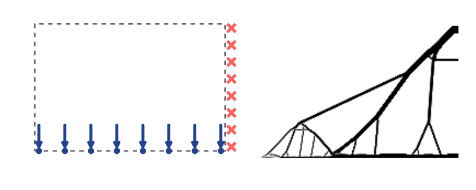
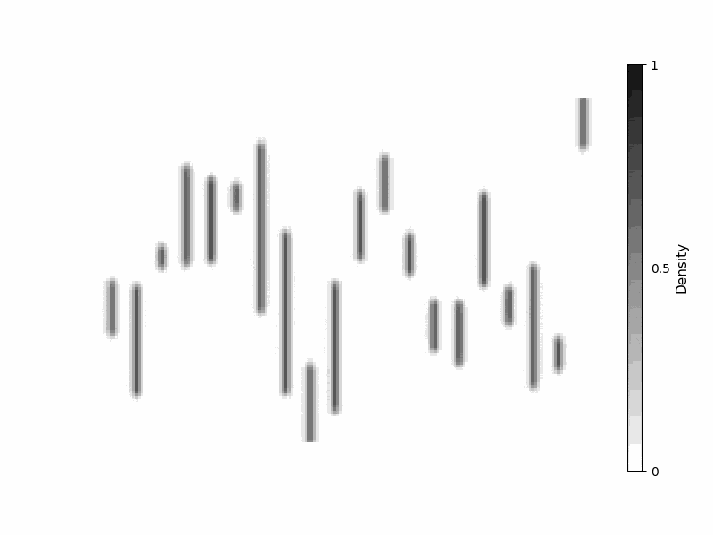

# Differentiable Stock Constraints for Continuous Optimization of Frame Structures by Reuse


This repository contains the official prototype implementation of the paper

**Differentiable Stock Constraints for Continuous Optimization of Frame Structures by Reuse**

by [Zhouyuan Chen](https://zhouyuan-chen.github.io/), [Marzia Riso](https://marzia-riso.github.io/), [Berend Baas](https://berendbaas.nl/), [Adriana Schulz](https://www.computationaldesign.group/adriana), and [Adrien Bousseau](https://www-sop.inria.fr/members/Adrien.Bousseau/).

## Description

The repository provides the core optimization framework together with several Jupyter notebooks demonstrating the main components of the method. Feel free to explore the notebooks and adapt the code for your own experiments. If you like it, please consider citing our work :)

- **`/top_opt_framework`** — Based on the codebase accompanying the paper [Neural Reparameterization Improves Structural Optimization](https://github.com/google-research/neural-structural-optimization) by Hoyer et al., with modifications for this project.
- **`basis_func_comparison.ipynb`** — Comparison of different basis functions.
- **`beams.ipynb`** — Generates the frame structure under beam stock constraints. **This is the main codebase for the project**; if you want to extend our work, we suggest starting here.
- **`teaser.ipynb`** — Generates the teaser figure.
- **`arc.ipynb`** — Generates the frame structure under arc stock constraints.

## Installation

```bash
# Clone the repository
git clone https://gitlab.inria.fr/zhochen/differentiable-stock-constraints-for-continuous-optimization-of-frame-structures-by-reuse.git
cd differentiable-stock-constraints-for-continuous-optimization-of-frame-structures-by-reuse

# (Recommended) create a virtual environment
python -m venv .venv
source .venv/bin/activate        # On Windows: .venv\Scripts\activate

# Install dependencies
pip install -r requirements.txt
```

## Usage

Launch Jupyter and open any of the notebooks:

```bash
jupyter notebook
```

To reproduce the main results, start with **`beams.ipynb`**. The other notebooks (`arc.ipynb`, `basis_func_comparison.ipynb`, `teaser.ipynb`) can be run independently to reproduce their respective figures and comparisons.

## Example




## Citation

If you use this code in your research, please cite:

```bibtex
@article{chen2025differentiable,
  title   = {Differentiable Stock Constraints for Continuous Optimization of Frame Structures by Reuse},
  author  = {Chen, Zhouyuan and Riso, Marzia and Baas, Berend and Schulz, Adriana and Bousseau, Adrien},
  journal = {<Venue>},
  year    = {<Year>}
}
```

## Acknowledgments

This project builds on [Neural Reparameterization Improves Structural Optimization](https://github.com/google-research/neural-structural-optimization) by Hoyer et al. We thank the authors for making their code available.

## License